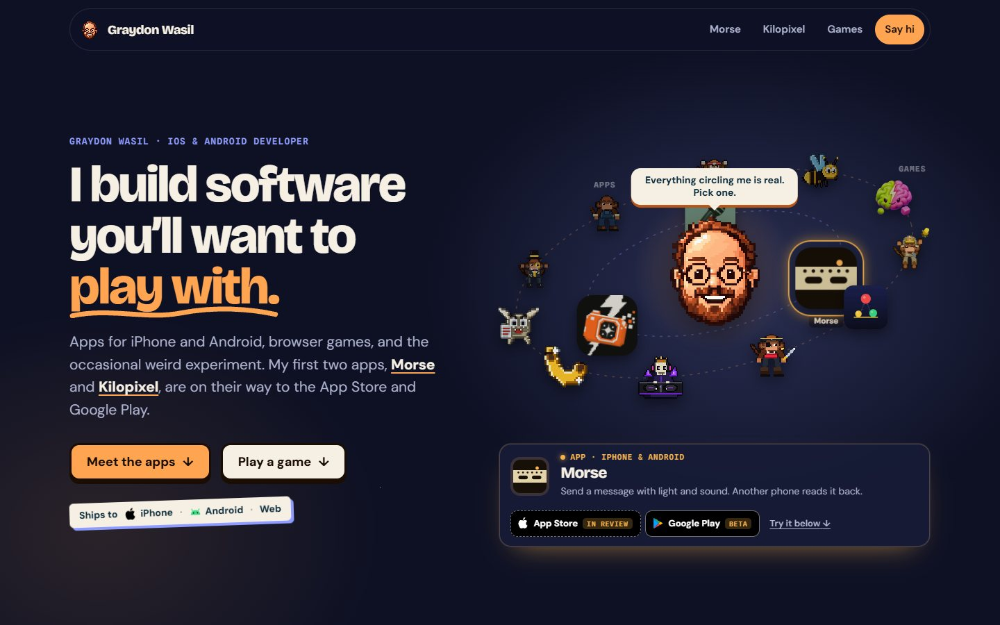
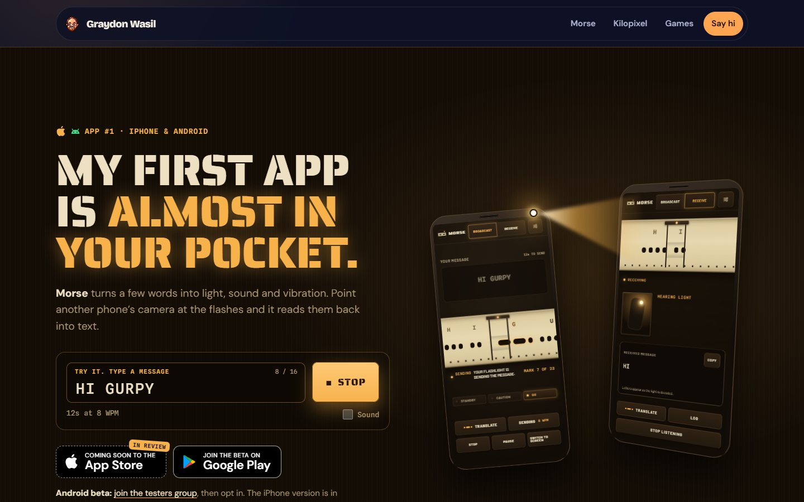
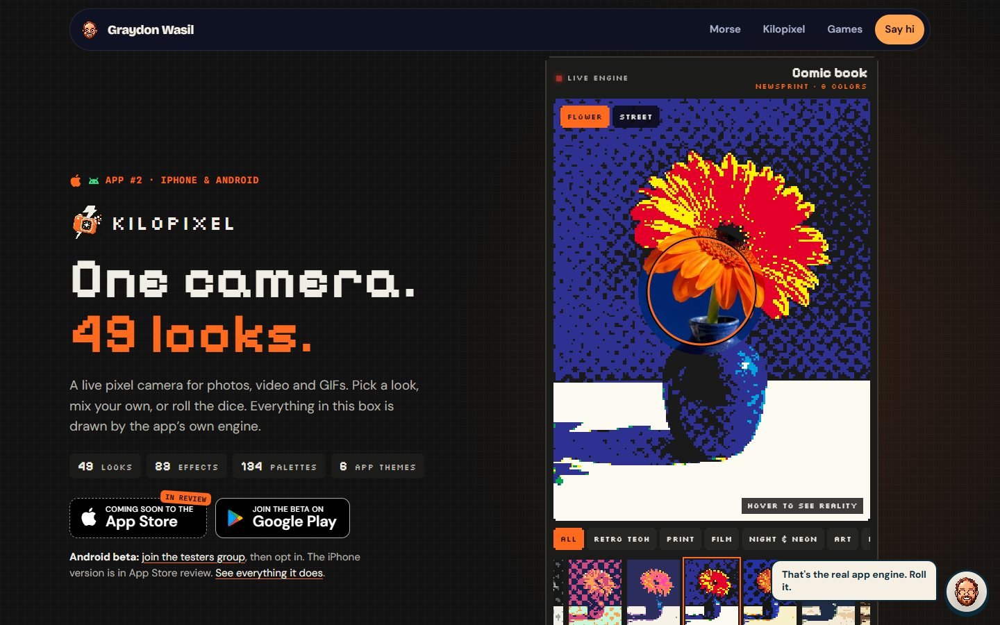
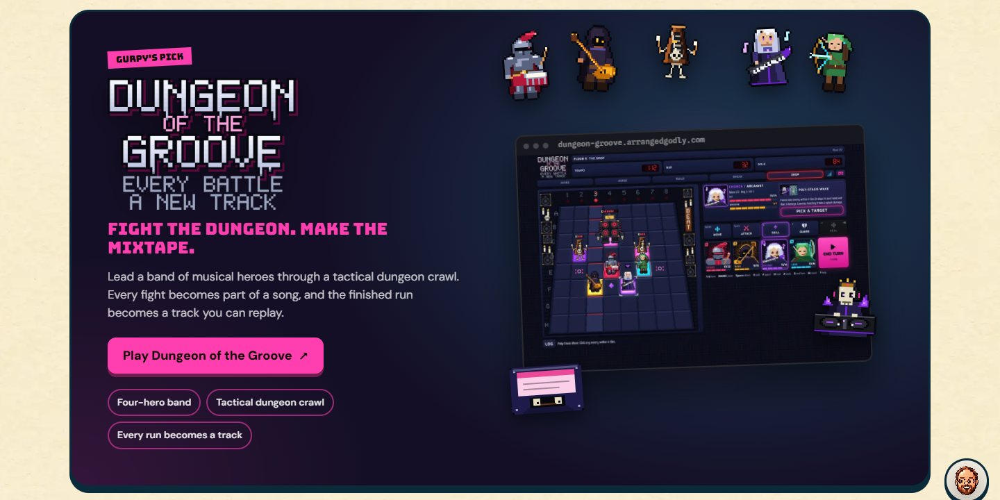
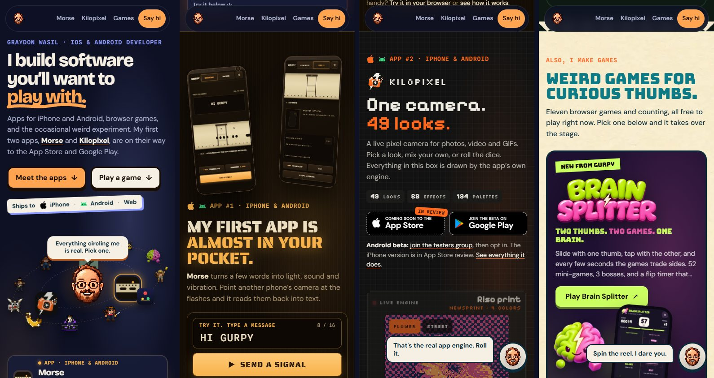

# Graydon Wasil · graydonwasil.com

**I build software you'll want to play with.**

This repository powers [graydonwasil.com](https://graydonwasil.com): one scrolling page that leads with Graydon's iPhone and Android apps and browser games, keeps older side projects in a compact strip, and ends with a contact form. Gurpy, the pixel-art mascot from [Gurpy Games](https://gg.arrangedgodly.com/), is the guide.



## What's on the page

| Section | What it does |
|---|---|
| **Hero** (`#top`) | Headline, "Meet the apps" and "Play a game", a "Ships to iPhone, Android, Web" label, and Gurpy with the apps on an inner ring and the games on an outer ring, orbiting around him. Pick anything in orbit and the card below shows it: apps get an App Store and a Google Play pill; for games, "See it below" opens that game's splash. Until you pick something, it gives a slow guided tour. Gurpy's eyes follow the pointer and he comments on each pick. |
| **Morse** (`#morse`) | App #1, for iPhone and Android. Type a message and two phones run the real Morse interface (its own markup and stylesheet) at the app's Standard speed, 8 WPM: the sender's Broadcast screen scrolls its paper tape while the flashlight in its top-right corner fires, and the receiver, turned toward it, shows its camera seeing the light, punches its own tape, and decodes the message letter by letter. Optional sound. App Store and Google Play buttons, the testers group, and the web app. |
| **Kilopixel** (`#kilopixel`) | App #2, for iPhone and Android, in its own world. A viewfinder runs Kilopixel's real engine on two sample photos: all 49 built-in looks in a filterable rail, a die to roll one, an auto-tour for passive visitors, and a lens that shows the original photo. Below: the real app in its six themes, a GIF it exported, and the feature list. On phones those three tiles swipe sideways. |
| **RhymePage** (`#rhymepage`) | A slim band for the web app, with a rehearse-in-time lyric toy. |
| **Games** (`#games`) | A splash card that takes on the selected game's branding from Gurpy Games (colours, logo, tagline, screen, and floating sprites that drift on their own and lean toward the pointer), a reel of all eleven games to pick from or spin, and links to the Gurpy Games and Infinite Monkey Industries hubs. |
| **More** (`#more`) | VOXCHAIN and CarsDB as logo tiles, Arranged Godly as its dream-device console, plus a drawer holding the 17 browser experiments. |
| **Hello** (`#hello`) | A short about, a photo, and the contact form. |

A small Gurpy follows you into the corner once the hero scrolls away and comments on each section. Type `gurpy` anywhere outside a text field for a surprise.









## Store status

Morse and Kilopixel are in App Store review and in Google Play closed testing. Every store button comes from one place: the `stores` field of `MORSE` and `KILOPIXEL` in `src/data/site.ts`. Each platform has a state:

| State | Button |
|---|---|
| `review` | "Coming soon to the App Store", dashed, with an "In review" flag. Not a link. |
| `beta` | "Join the beta on Google Play" (or "Test it on TestFlight" for iOS), linking to the tester opt-in. |
| `live` | "Download on the App Store" / "Get it on Google Play", linking to the listing. |

The tester notes under each pair ("Android beta: join the testers group", "The iPhone version is in App Store review.") follow the same states, so they disappear on their own.

**When Apple approves an app:** set its `ios` to `{ state: 'live', url: 'https://apps.apple.com/app/id<Apple ID>' }`. The Apple ID is the number under App Information in App Store Connect. **When a Play listing goes public:** set `android` to `{ state: 'live', url: 'https://play.google.com/store/apps/details?id=...' }` (the URLs are in comments beside each app). The two buttons are drawn to match each other; Apple's and Google's official badges can replace them once both listings are public.

## Run locally

Requires Node `^20.19.0 || >=22.12.0`.

```sh
npm ci
npm run dev
```

| Command | Purpose |
|---|---|
| `npm run dev` | Vite dev server |
| `npm run build` | TypeScript check, then production build to `dist/` |
| `npm run preview` | Preview the production build |
| `npm run lint` | Oxlint |

## Where things live

| Location | What belongs there |
|---|---|
| `src/data/site.ts` | App store states and links, orbit items, game hubs, side projects |
| `src/data/games.json` + `src/assets/games/` | Generated game branding (per-game floater fixes for this site live in `FLOATER_FIX` in `src/data/games.ts`, so a re-sync keeps them). Run `python scripts/sync-games.py` (needs Pillow and the `arcade-ad` repo beside this one) after Gurpy Games changes |
| `src/data/experiments.ts` | The 17 experiments |
| `src/components/` | One component per section, plus `GurpyFace` (the canvas mascot), `Orbit` (the hero rings), and `StoreButtons` (the App Store and Google Play pair) |
| `src/styles/morse-app.css` + `src/components/MorsePhones.tsx` | The Morse app's own stylesheet, scoped under `.mapp` and limited to its phone layout, and the app's markup for the two demo phones. Regenerate the CSS with `python scripts/sync-morse-ui.py [path/to/morse-code/native-web]` after the app's look changes; demo-only tweaks live in `site.css` under `.mapp`. |
| `src/vendor/kilopixel/` | A snapshot of Kilopixel's engine (renderer, looks, palettes) from `1bit-camera/kilopixel-site/src/engine` at 1bit-camera 02edd55, loaded only when the Kilopixel section comes near. To refresh it, copy those files again; `renderer.ts` has one local change (its constructor parameter property is written out, for `erasableSyntaxOnly`). It is excluded from lint. |
| `src/lib/morse.ts` | Morse alphabet and signal timing |
| `src/styles/site.css` | All styles; each section's palette is defined at the top |
| `src/assets/fun/` | Mascot, side-project marks, and the Arranged Godly device |
| `src/assets/kilopixel/` | Kilopixel's sample photos, app screenshots in six themes, and the jellyfish GIF |

Art sources: Gurpy and all game art come from the `arcade-ad` (Gurpy Games) repo; the VOXCHAIN mark and wordmark and the CarsDB mark come from those live sites; the Arranged Godly image is a capture of the live site; Kilopixel's photos, screenshots and GIF come from `1bit-camera/kilopixel-site/public/assets` (the jellyfish footage is by Fastily, CC BY-SA 4.0, credited on the page).

## Old links

The previous site was a slide deck with one URL per slide. `src/main.tsx` maps those paths to sections: `/games` goes to `#games`, `/projects/*` and `/experiments` go to `#more`, `/about` and `/contact` go to `#hello`, and anything else goes to the top. The host still needs to return `index.html` for unknown paths.

## Contact delivery

Copy `.env.example` to `.env.local` and set `VITE_CONTACT_ENDPOINT` to a form endpoint you control. It receives a JSON POST of `name`, `email`, and `message`. If the endpoint rejects the message, the form keeps it and offers an email-app fallback. With no endpoint, the form opens a pre-filled `mailto:` instead; that hands off the draft, it does not confirm delivery. `VITE_` values are public, so never put secrets there.

## Accessibility and motion

Under `prefers-reduced-motion`, the orbit holds still with no guided tour, the Kilopixel viewfinder neither auto-rolls nor animates VHS looks, Gurpy stops blinking, the float, pop and scroll-reveal animations are off, and the reel jumps instead of spinning. The Morse lamp only flashes in a small area when you start it, and it stays under 5 flashes a second. Orbit items, reel cards and every link are real buttons or links reachable by keyboard; focusing an orbit item stops its ring.

## Stack

React 19, TypeScript 6, Vite 8, Oxlint. No router or animation library. Output is static files in `dist/`.
