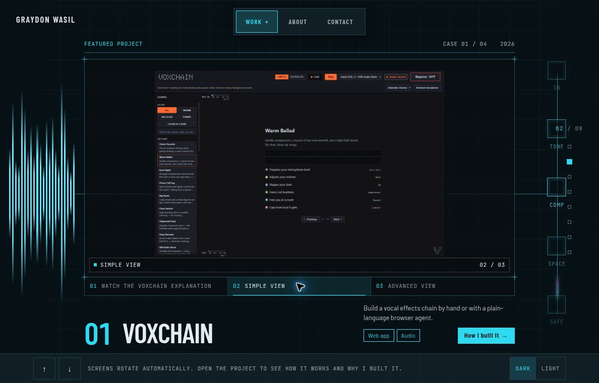
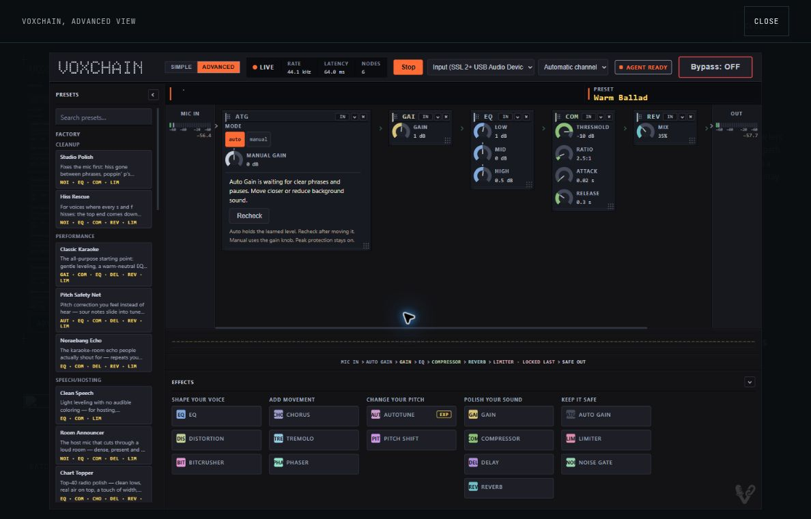
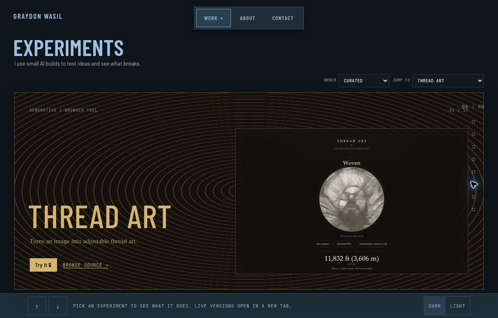

# Graydon Wasil · Portfolio Website

**A full-viewport portfolio that turns projects into an explorable deck.**

This repository powers [graydonwasil.com](https://graydonwasil.com): featured software projects, a collection of browser experiments, deeper project views, and a contact surface. Procedural animated scenes give each featured build a visual identity; real screenshots and linked demos provide the closer look.



*The live featured deck showing VOXCHAIN’s Simple View inside the portfolio’s stylized frame.*

[Visit the website](https://graydonwasil.com/) · [Run locally](#run-locally) · [Content and media](#update-projects-and-media)

## Explore the work

The current data defines **four featured projects**: VOXCHAIN, Rhymepage, CarsDB, and Arranged Godly. A separate collection holds **17 experiments**, covering creative tools, simulations, music, utilities, and other browser projects.

The opening introduces KiloPixel, Morse, and RhymePage as apps being prepared for Google Play, followed by the Gurpy Games and Infinite Monkey Industries collections at `/games`. The existing project stories and experiments follow. Current app and game links live in `src/data/currentWork.ts`; Google Play preparation is a development status, not a store-availability claim.

| Surface | Purpose |
|---|---|
| **Featured deck** | A focused introduction to each major project |
| **Project detail** | More context, a gallery, and links to the actual work |
| **Screenshot viewer** | A larger view of the project interface |
| **Experiments** | Browse the wider collection in curated, alphabetical, or newest-first order |
| **Contact** | Prepare a message through an optional form endpoint or an email-client handoff |



*The full-size viewer shows actual project interface imagery. The surrounding animated scenes are stylized presentation, not a live connection to the featured app.*



*Thread Art appears in the 17-item experiment collection.*

## Navigation

The deck remains mounted while the URL determines its active slide and any deeper view, allowing movement between projects without rebuilding the whole shell.

| Input | Deck behavior |
|---|---|
| **Arrow Down / Right**, **Page Down**, **Space** | Next slide |
| **Arrow Up / Left**, **Page Up**, **Shift+Space** | Previous slide |
| **Mouse wheel / trackpad** | Discrete slide navigation, with a short lock to absorb momentum |
| **Vertical swipe on coarse-pointer devices** | Outer deck navigation, disabled while a detail view is open |
| **On-screen navigation** | Jump through the site without keyboard shortcuts |

Keyboard and wheel handlers defer to text fields and modal dialogs rather than moving the deck underneath the visitor. An open navigation menu also owns its keyboard handling. Nested experiment navigation can consume wheel and touch gestures before handing control back to the outer deck at its endpoints.

The site supports dark/light themes and saves the visitor’s theme choice locally. Reduced-motion preferences replace or simplify motion, including the procedural featured scenes.

When a view is taller than the available space, it scrolls inside the fixed navigation. Wheel input scrolls that view before moving through the deck, touch uses native scrolling, and a focused scrolling view keeps the arrow and page keys for reading.

## Run locally

The pinned Vite, React plugin, and Oxlint dependencies require Node `^20.19.0 || >=22.12.0`. Use a compatible maintained runtime; the application package itself does not declare an engine range.

```sh
git clone https://github.com/Arrangedgodly/graydonwasil-com.git
cd graydonwasil-com
npm ci
npm run dev
```

Open the address printed by Vite.

| Command | Purpose |
|---|---|
| `npm run dev` | Start the Vite development server |
| `npm run build` | Run TypeScript project checking, then create `dist/` |
| `npm run preview` | Preview the production build locally |
| `npm run lint` | Run Oxlint |
| `node scripts/check-wheel-handoff.mjs` | Run a focused static source guard for wheel/touch navigation handoff |

The handoff guard checks source patterns. It is not an end-to-end browser test, and the current package does not define a general `npm test` command. Verify keyboard, wheel, touch, modal, and direct-route behavior in a real browser after relevant changes.

## Update projects and media

| Location | What belongs there |
|---|---|
| `src/data/projects.ts` | Featured-project and experiment records, links, ordering data, and gallery slots |
| `src/assets/screenshots/` | Real screenshots of the showcased applications |
| `src/assets/experiments/` | Experiment thumbnails |
| `src/components/ProjectScene.tsx` | Current procedural animated scenes |
| `src/assets/project-portals/` | Retained portal artwork and loop assets, separate from the current scene renderer |
| `src/lib/useDeckDrivers.ts` | Wheel and keyboard navigation behavior |
| `src/pages/Contact.tsx` | Contact validation, endpoint request, and email fallback |

### Screenshots

Screenshots use the project ID and gallery slot:

```text
{project.id}-{slot}-{light|dark}[-mobile].{ext}
```

Slots are `hero`, `shot-2`, and `shot-3`. Supported image extensions include WebP, AVIF, PNG, JPG, and JPEG. Keep light/dark pairs on the same page, scroll position, and data state so theme changes do not make the composition jump.

On narrow screens, a matching mobile image takes priority; otherwise the resolver falls back to the desktop version. Missing assets use an explicit placeholder instead of silently disappearing. VOXCHAIN’s gallery also includes its YouTube explanation alongside interface stills.

See the [screenshot guide](src/assets/screenshots/README.md) and [shot list](src/assets/screenshots/SHOT-LIST.md) before adding or replacing assets.

### Current scenes and retained portal assets

The featured slides currently render `ProjectScene`: procedural Motion components with project-themed shapes, readouts, and animation. These are stylized illustrations of a product’s character, not its live data or a recording of its controls. Reduced-motion variants use still poses.

The repository also retains portal artwork, landscape/portrait MP4s, and a [portal-media guide](src/assets/project-portals/README.md). That guide describes a six-second video-loop design, but the current `ProjectSlide`/`ProjectScene` path does not use that MP4 player. Keep retained media and current runtime behavior distinct when updating the documentation.

### Optional screenshot capture helper

```sh
npm run capture:setup
npm run capture
```

This is separate from ordinary development setup. `capture:setup` installs Playwright and Sharp without saving them to `package.json`, then downloads Chromium. The capture helper uses a persistent browser profile so sign-ins can be reused. Its current target list covers RhymePage, CarsDB, and Arranged Godly; extend `TARGETS` to capture another project such as VOXCHAIN. Use it only with sites and accounts you intend to capture, and inspect images for private information before committing them.

## Configure contact delivery

Copy `.env.example` to `.env.local`. Set `VITE_CONTACT_ENDPOINT` only if the form should send to an endpoint you control:

```dotenv
VITE_CONTACT_ENDPOINT=https://example.com/your-form-endpoint
```

The endpoint receives a JSON POST containing `name`, `email`, and `message`. A non-success response enters the error state, where the visitor can retry or open the message in an email app.

With no endpoint configured, the form opens a `mailto:` link to `hello@graydonwasil.com`. This hands the draft to the visitor’s email client; it does not prove that the message was sent or delivered. The current interface moves to its sent presentation after that handoff, so do not use that display as a delivery receipt.

`VITE_` variables are exposed in the client bundle. Do not put API secrets or credentials in this setting. The repository contains the front end, not a contact-email backend.

The README screenshots were captured from the live website on October 5, 2026. Their identity and project content match the inspected source, but the live deployment’s exact commit was not exposed. The captured viewer contains an embedded project screenshot, not a running instance of VOXCHAIN.

## Stack and deployment

The site uses **React 19**, **TypeScript 6**, **Vite 8**, **React Router 7**, **Motion 13**, and **Oxlint**. Its production output is static content under `dist/`.

For a static host, use `npm run build` and publish `dist/`. Configure single-page-app fallback to `index.html` so direct visits to detail and project routes resolve correctly. If a contact service is used, provide the endpoint in the host’s build environment as well.

The repository does not currently include a CI workflow or a general software license file. Verify build/lint results and applicable code/media permissions before redistributing or deploying a copy. No test badge or delivery guarantee is implied by this README.
